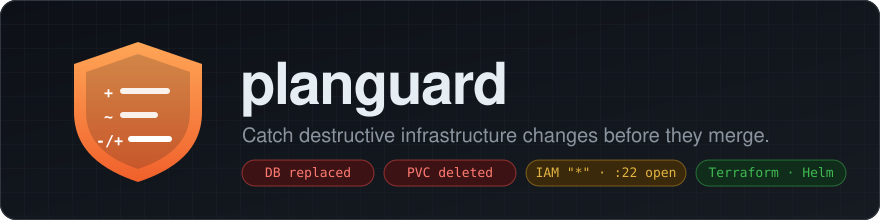
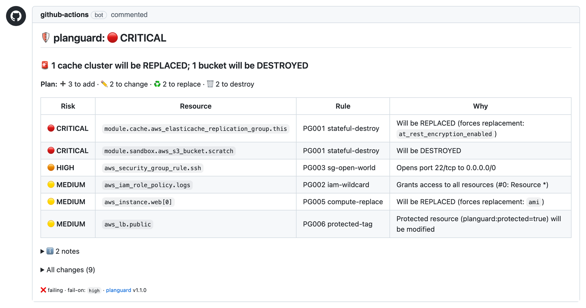
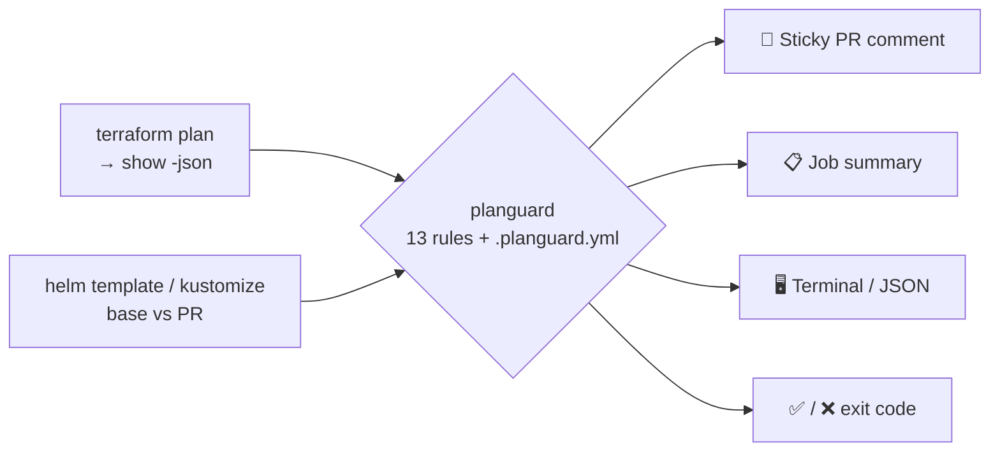
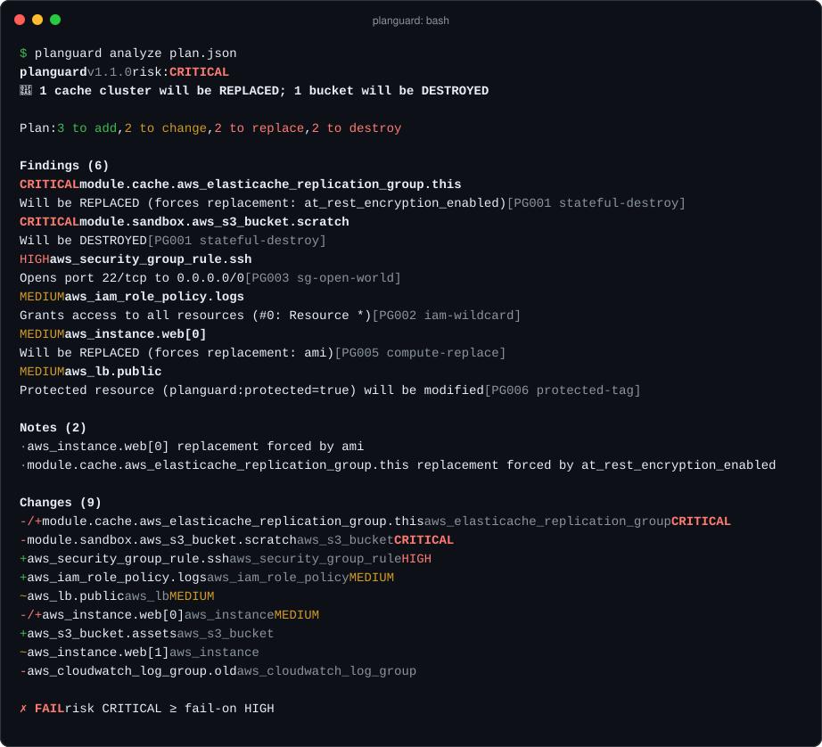

<p align="center">
  
</p>

<p align="center">
  <a href="https://github.com/ArthuR1CP/planguard/actions/workflows/ci.yml"></a>
  <a href="https://github.com/ArthuR1CP/planguard/actions/workflows/demo.yml"></a>
  <a href="https://github.com/ArthuR1CP/planguard/releases/latest"></a>
  
  = 1.5">
  
  <a href="LICENSE"></a>
</p>

<p align="center">
  <b>planguard reads your <code>terraform plan</code> or your rendered Helm/Kubernetes manifests and tells reviewers,<br>
  in one PR comment, when a change would delete data, expose something to the internet, or grant <code>"*"</code>.</b>
</p>

<p align="center">
  <a href="#-quickstart">Quickstart</a> ·
  <a href="#-how-it-works">How it works</a> ·
  <a href="#-rules">Rules</a> ·
  <a href="#%EF%B8%8F-configuration">Configuration</a> ·
  <a href="#%EF%B8%8F-cli">CLI</a> ·
  <a href="#-how-is-this-different-from-checkov--tfsec--kube-linter--infracost">Why not Checkov?</a>
</p>

---

## 💥 The problem

A one-line change like `storage_encrypted = true` looks harmless in a diff. Terraform's plan says `-/+ must be replaced`, buried on line 412 of a CI log nobody reads. The PR gets approved, and the production database is **recreated empty**.

Helm has the same problem. Flipping `cache.enabled: false` in a values file quietly deletes a PersistentVolumeClaim, and changing a StatefulSet's storage class breaks the next `helm upgrade`.

planguard turns the change into a comment reviewers can't miss:

<p align="center">
  
</p>

- **One sticky comment.** Every push updates the same comment instead of adding a new one.
- **Fails the check** when the risk is at or above your `fail-on` level (default `high`).
- **Job summary.** The same report also appears on the workflow run page.

## 🚀 Quickstart

### Terraform

```yaml
# .github/workflows/terraform.yml
on: pull_request
permissions: { contents: read, pull-requests: write }
jobs:
  plan:
    runs-on: ubuntu-latest
    steps:
      - uses: actions/checkout@v4
      - uses: hashicorp/setup-terraform@v3
        with: { terraform_wrapper: false }
      - run: terraform init && terraform plan -out=tfplan && terraform show -json tfplan > plan.json
      - uses: ArthuR1CP/planguard@v1
        with: { plan-json: plan.json, fail-on: high }
```

> [!IMPORTANT]
> Set `terraform_wrapper: false`. The wrapper adds extra text to stdout, and the result is no longer valid JSON.

### Kubernetes / Helm (beta)

Point planguard at a chart. It renders the chart on the PR's base commit and on the PR head, then compares the two:

```yaml
on: pull_request
permissions: { contents: read, pull-requests: write }
jobs:
  helm:
    runs-on: ubuntu-latest # helm is preinstalled on GitHub-hosted runners
    steps:
      - uses: actions/checkout@v4
      - uses: ArthuR1CP/planguard@v1
        with:
          helm-chart: charts/shop
          helm-values: charts/shop/values-prod.yaml
```

Using Kustomize or plain YAML? Render both sides yourself and pass `k8s-before` / `k8s-after` (use `/dev/null` when nothing existed before). Running Terraform and Helm in the same workflow? Give each step its own `comment-id` so they keep separate comments.

<details>
<summary><b>Action inputs and outputs</b></summary>

Set exactly one mode: `plan-json`, `k8s-before` + `k8s-after`, or `helm-chart`.

| Input | Default | Description |
|---|---|---|
| `plan-json` | | Terraform: path to `terraform show -json` output |
| `k8s-before` / `k8s-after` | | Manifests: YAML file or directory for each side (`/dev/null` = nothing) |
| `helm-chart` | | Helm: chart directory; rendered on the PR base and head |
| `helm-values` | | Helm: values files, comma or newline separated |
| `helm-release` / `helm-namespace` | chart name / `default` | Helm: release name and namespace for `helm template` |
| `helm-base-ref` | PR base commit | Helm: git ref to compare against |
| `config` | `./.planguard.yml` if present | Config file path |
| `fail-on` | `high` (or config) | `low` \| `medium` \| `high` \| `critical` \| `none` |
| `comment` | `true` | Create/update the sticky PR comment |
| `comment-id` | | Separate sticky comment per id (e.g. `terraform`, `helm`) |
| `github-token` | `${{ github.token }}` | Needs `pull-requests: write` |

| Output | Example |
|---|---|
| `mode` | `terraform` or `k8s` |
| `risk` | `CRITICAL` |
| `failed` | `true` |
| `headline` | `🚨 1 database will be REPLACED` |
| `report-markdown` / `report-json` | paths to the generated reports |

On PRs from forks the token is read-only. The comment step then logs a warning instead of failing, and the job summary still shows the report.

</details>

## 🔍 How it works



For Terraform, planguard reads `resource_changes` from the plan. For Kubernetes, it pairs objects by `kind/namespace/name` across the two renders, and treats a change to an immutable field (a selector, `volumeClaimTemplates`, a PVC's storage class) as a replacement. Every change is classified as create, update, delete, replace or no-op, and then every rule runs against its `before` and `after` values. The overall risk is the highest-risk finding.

## 📏 Rules

### Terraform

| ID | Rule | Risk | Fires on |
|---|---|---|---|
| PG001 | `stateful-destroy` | 🔴 CRITICAL | Delete or replace of stateful resources: RDS/Aurora, DynamoDB, S3, EFS/EBS/FSx, ElastiCache, OpenSearch, Redshift, KMS, Cloud SQL, GCS, BigQuery, Spanner, Azure SQL/Postgres/MySQL/Cosmos, storage accounts, Key Vault and others |
| PG002 | `iam-wildcard` | 🟠 HIGH | Allow statements with `Action: "*"`, `"svc:*"` or `NotAction`, or an `AdministratorAccess` attachment. Only 🟡 MEDIUM when the sole wildcard is `Resource: "*"` |
| PG003 | `sg-open-world` | 🟠 HIGH | Ingress from `0.0.0.0/0` or `::/0` on ports other than 80/443 (AWS security groups and their rules, GCP firewalls, Azure NSGs) |
| PG004 | `mass-delete` | 🟠 HIGH | More than `max_deletes` (default 5) resources destroyed or replaced in one plan |
| PG005 | `compute-replace` | 🟡 MEDIUM | Replacement of instances, launch templates, ASGs, EKS/GKE/AKS clusters and node pools, VMs. Only 🟢 LOW with `create_before_destroy` (new one is up before the old one goes away) |
| PG006 | `protected-tag` | 🟡 MEDIUM | Change to a resource tagged `planguard:protected=true` (🟠 HIGH if destroyed or replaced) |
| PG007 | `forces-replacement` | 🟢 LOW | Lists the attributes forcing each replacement (from Terraform's `replace_paths`) |

### Kubernetes / Helm (beta)

| ID | Rule | Risk | Fires on |
|---|---|---|---|
| PG101 | `k8s-stateful-delete` | 🔴 CRITICAL | Delete of a PersistentVolumeClaim, PersistentVolume, StatefulSet, Namespace or CRD (deleting a CRD deletes every object of its kind), or recreation of a PVC/PV/Namespace/CRD |
| PG102 | `k8s-immutable-change` | 🟠 HIGH | Change to an immutable field: workload `selector`, StatefulSet `volumeClaimTemplates` / `serviceName`, Service `clusterIP`, PVC `storageClassName` / `accessModes`, binding `roleRef`, data of an `immutable: true` ConfigMap/Secret |
| PG103 | `k8s-public-exposure` | 🟠 HIGH | A Service becomes a public `LoadBalancer` or gets `externalIPs` (🟡 MEDIUM for `NodePort`), or an Ingress serves a new host. Internal load balancer annotations (AWS, GCP, Azure, OCI) and restrictive `loadBalancerSourceRanges` are respected |
| PG104 | `k8s-rbac-wildcard` | 🟠 HIGH | Role/ClusterRole with `"*"` verbs or resources, a binding to `cluster-admin`, or a binding for `system:anonymous` / `system:unauthenticated` |
| PG105 | `k8s-capacity-drop` | 🟡 MEDIUM | A Deployment/StatefulSet scaled to 0 replicas, or a PodDisruptionBudget deleted |
| PG106 | `k8s-pod-privileged` | 🟡 MEDIUM | Pods gain privileged containers, `hostNetwork` / `hostPID` / `hostIPC`, `hostPath` volumes, or `SYS_ADMIN` / `NET_ADMIN` capabilities |

PG004 (`mass-delete`) and PG006 (`protected`) apply to both. In Kubernetes, mark an object as protected with the label or annotation `planguard/protected: "true"`.

> [!NOTE]
> Security rules (PG002, PG003, PG103, PG104, PG106) report only what the change **introduces**. A tag change on an existing wildcard policy is not reported again.
> A plan with changes but no findings is `LOW`; an empty plan is `NONE`.
> `create_before_destroy` lowers PG005 but not PG001: it avoids downtime, but a replaced database or bucket still starts empty and the old one is still destroyed.

## ⚙️ Configuration

Every key in `.planguard.yml` is optional:

```yaml
fail_on: high                  # low | medium | high | critical | none
thresholds:
  max_deletes: 5               # PG004
stateful_types:                # added to the built-in list, globs allowed
  - aws_opensearch_domain
  - "aws_mq_*"
compute_types: [aws_batch_compute_environment]
stateful_kinds:                # Kubernetes kinds treated like PVCs (PG101), globs allowed
  - Cluster                    # e.g. CloudNativePG clusters
ignore:                        # address globs, skipped entirely
  - "module.sandbox.*"
  - "ConfigMap/*"              # Kubernetes addresses are Kind/namespace/name
protected_tags:                # PG006: Terraform tags or Kubernetes labels/annotations
  planguard:protected: "true"
  planguard/protected: "true"
  criticality: "*"
public_ports: [80, 443]        # PG003 allow-list for 0.0.0.0/0
rules:                         # turn a rule off or change its level
  PG005: off
  PG002: critical
```

Unknown keys cause an error (exit 2), so typos don't get ignored silently. The `--fail-on` flag and the action input override `fail_on`.

## 🖥️ CLI

The GitHub Action is a thin wrapper around a CLI that also runs locally, or in GitLab CI, Jenkins or a pre-commit hook.

```bash
pip install git+https://github.com/ArthuR1CP/planguard@v1

# Terraform
terraform plan -out=tfplan && terraform show -json tfplan > plan.json
planguard analyze plan.json

# Helm / Kubernetes: render both sides and compare
helm template shop ./chart -f values-old.yaml > before.yaml
helm template shop ./chart -f values-new.yaml > after.yaml
planguard k8s before.yaml after.yaml
```

<p align="center">
  
</p>

| Command | What it does |
|---|---|
| `planguard analyze plan.json` | Colored summary in a terminal, Markdown when piped |
| `planguard analyze plan.json -f md` | Markdown, e.g. to paste into a PR |
| `planguard analyze plan.json -f json` | Machine-readable report |
| `planguard analyze plan.json --fail-on critical -c .planguard.yml` | Custom threshold and config |
| `planguard analyze - < plan.json` | Read the plan from stdin |
| `planguard k8s before.yaml after.yaml` | Compare two renders (files or directories) |
| `planguard k8s /dev/null after.yaml` | Everything is new, e.g. a first install |
| `planguard rules` | List the built-in rules |

**Exit codes:** `0` OK · `1` risk ≥ `fail-on` · `2` invalid input or config.
Colors follow [`NO_COLOR`](https://no-color.org) and `FORCE_COLOR`, or pass `--no-color`. `--output` and `--json-output` write both formats in a single run.

## 🤔 How is this different from Checkov / tfsec / kube-linter / Infracost?

| Tool | Question it answers |
|---|---|
| Checkov, tfsec, Trivy, KICS | *Is this configuration secure?* Static analysis of `.tf` / YAML files |
| kube-linter, Polaris, kubeconform | *Is this manifest well-formed and following best practices?* |
| Infracost | *How much will this cost?* |
| **planguard** | ***What does this change destroy or expose, and how bad is it?*** The blast radius of one specific change |

planguard looks at the **diff** (the plan, or before vs after), not at the code. It knows that `storage_encrypted = true` on an existing RDS instance means data loss, even though the setting itself passes every security scanner. Run it **next to** your scanner, not instead of it.

**Lightweight:** one dependency (PyYAML), no API keys, no account, and it runs in about a second.

## 🗺️ Roadmap

- [x] **Kubernetes / Helm** (beta in v1.2)
- [ ] **OpenTofu:** test against `tofu show -json` and document it (the format is already compatible)
- [ ] **Kustomize mode** in the action (render base and head, like `helm-chart`)
- [ ] **Argo CD / Flux:** read the app diff directly
- [ ] **Pulumi:** support `pulumi preview --json`
- [ ] **Optional LLM summary:** a plain-English "what this PR really does" (opt-in, bring your own key)
- [ ] `moved`/`removed` block awareness, so planned refactors don't trigger PG004
- [ ] SARIF output for GitHub code scanning
- [ ] PyPI release

Ideas and bug reports are welcome. Open an [issue](https://github.com/ArthuR1CP/planguard/issues).

## 🛠️ Development

```bash
python -m venv .venv && . .venv/bin/activate
pip install -e ".[dev]"
pytest && ruff check . && ruff format --check .
```

The [`demo`](.github/workflows/demo.yml) workflow dogfoods the action. It runs a real `terraform plan` on [`examples/`](examples) (only the `null` and `local` providers, so no cloud credentials are needed), renders the example chart in [`examples/helm/`](examples/helm) with two values files, and calls `uses: ./` on both. See [CONTRIBUTING.md](CONTRIBUTING.md) for how to add a rule.

## 📄 License

[MIT](LICENSE) © ArthuR1CP
