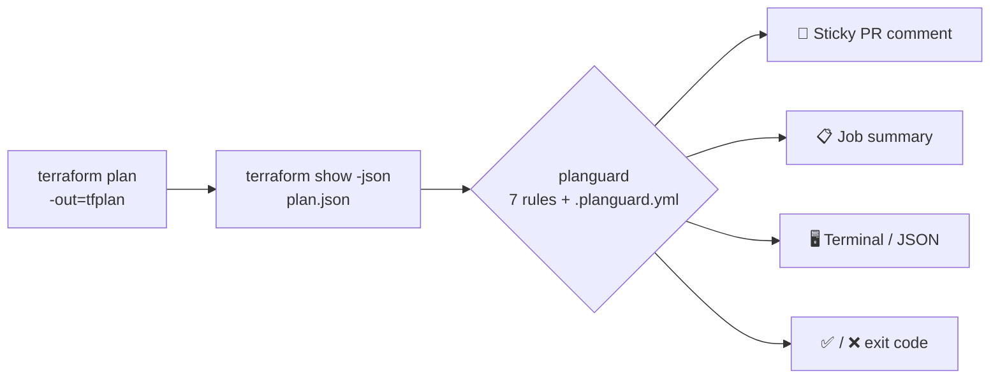

<p align="center">
  
</p>

<p align="center">
  <a href="https://github.com/ArthuR1CP/planguard/actions/workflows/ci.yml"></a>
  <a href="https://github.com/ArthuR1CP/planguard/actions/workflows/demo.yml"></a>
  <a href="https://github.com/ArthuR1CP/planguard/releases/latest"></a>
  
  = 1.5">
  <a href="LICENSE"></a>
</p>

<p align="center">
  <b>planguard reads your <code>terraform plan</code> and tells reviewers, in one PR comment,<br>
  when a change would destroy a database, open SSH to the world, or grant <code>"*"</code> in IAM.</b>
</p>

<p align="center">
  <a href="#-quickstart">Quickstart</a> ·
  <a href="#-how-it-works">How it works</a> ·
  <a href="#-rules">Rules</a> ·
  <a href="#%EF%B8%8F-configuration">Configuration</a> ·
  <a href="#%EF%B8%8F-cli">CLI</a> ·
  <a href="#-how-is-this-different-from-checkov--tfsec--infracost">Why not Checkov?</a>
</p>

---

## 💥 The problem

A one-line change like `storage_encrypted = true` looks harmless in a diff. Terraform's plan says `-/+ must be replaced`, buried on line 412 of a CI log nobody reads. The PR gets approved, and the production database is **recreated empty**.

planguard turns the plan into a comment reviewers can't miss:

<p align="center">
  
</p>

- **One sticky comment.** Every push updates the same comment instead of adding a new one.
- **Fails the check** when the risk is at or above your `fail-on` level (default `high`).
- **Job summary.** The same report also appears on the workflow run page.

## 🚀 Quickstart

```yaml
# .github/workflows/terraform.yml
on: pull_request
permissions: { contents: read, pull-requests: write }
jobs:
  plan:
    runs-on: ubuntu-latest
    steps:
      - uses: actions/checkout@v4
      - uses: hashicorp/setup-terraform@v3
        with: { terraform_wrapper: false }
      - run: terraform init && terraform plan -out=tfplan && terraform show -json tfplan > plan.json
      - uses: ArthuR1CP/planguard@v1
        with: { plan-json: plan.json, fail-on: high }
```

> [!IMPORTANT]
> Set `terraform_wrapper: false`. The wrapper adds extra text to stdout, and the result is no longer valid JSON.

<details>
<summary><b>Action inputs and outputs</b></summary>

| Input | Default | Description |
|---|---|---|
| `plan-json` | (required) | Path to `terraform show -json` output |
| `config` | `./.planguard.yml` if present | Config file path |
| `fail-on` | `high` (or config) | `low` \| `medium` \| `high` \| `critical` \| `none` |
| `comment` | `true` | Create/update the sticky PR comment |
| `github-token` | `${{ github.token }}` | Needs `pull-requests: write` |

| Output | Example |
|---|---|
| `risk` | `CRITICAL` |
| `failed` | `true` |
| `headline` | `🚨 1 database will be REPLACED` |
| `report-markdown` / `report-json` | paths to the generated reports |

On PRs from forks the token is read-only. The comment step then logs a warning instead of failing, and the job summary still shows the report.

</details>

## 🔍 How it works



planguard reads `resource_changes` from the plan and classifies each change as create, update, delete, replace or no-op. It then runs every rule against the change and its `before` and `after` values. The overall risk is the highest-risk finding.

## 📏 Rules

| ID | Rule | Risk | Fires on |
|---|---|---|---|
| PG001 | `stateful-destroy` | 🔴 CRITICAL | Delete or replace of stateful resources: RDS/Aurora, DynamoDB, S3, EFS/EBS/FSx, ElastiCache, OpenSearch, Redshift, KMS, Cloud SQL, GCS, BigQuery, Spanner, Azure SQL/Postgres/MySQL/Cosmos, storage accounts, Key Vault and others |
| PG002 | `iam-wildcard` | 🟠 HIGH | Allow statements with `Action: "*"`, `"svc:*"` or `NotAction`, or an `AdministratorAccess` attachment. Only 🟡 MEDIUM when the sole wildcard is `Resource: "*"` |
| PG003 | `sg-open-world` | 🟠 HIGH | Ingress from `0.0.0.0/0` or `::/0` on ports other than 80/443 (AWS security groups and their rules, GCP firewalls, Azure NSGs) |
| PG004 | `mass-delete` | 🟠 HIGH | More than `max_deletes` (default 5) resources destroyed or replaced in one plan |
| PG005 | `compute-replace` | 🟡 MEDIUM | Replacement of instances, launch templates, ASGs, EKS/GKE/AKS clusters and node pools, VMs |
| PG006 | `protected-tag` | 🟡 MEDIUM | Change to a resource tagged `planguard:protected=true` (🟠 HIGH if destroyed or replaced) |
| PG007 | `forces-replacement` | 🟢 LOW | Lists the attributes forcing each replacement (from Terraform's `replace_paths`) |

> [!NOTE]
> PG002 and PG003 report only grants or exposures **introduced** by the plan. A tag change on an existing wildcard policy is not reported again.
> A plan with changes but no findings is `LOW`; an empty plan is `NONE`.

## ⚙️ Configuration

Every key in `.planguard.yml` is optional:

```yaml
fail_on: high                  # low | medium | high | critical | none
thresholds:
  max_deletes: 5               # PG004
stateful_types:                # added to the built-in list, globs allowed
  - aws_opensearch_domain
  - "aws_mq_*"
compute_types: [aws_batch_compute_environment]
ignore:                        # resource address globs, skipped entirely
  - "module.sandbox.*"
protected_tags:                # PG006; "*" matches any value
  planguard:protected: "true"
  criticality: "*"
public_ports: [80, 443]        # PG003 allow-list for 0.0.0.0/0
rules:                         # turn a rule off or change its level
  PG005: off
  PG002: critical
```

Unknown keys cause an error (exit 2), so typos don't get ignored silently. The `--fail-on` flag and the action input override `fail_on`.

## 🖥️ CLI

The GitHub Action is a thin wrapper around a CLI that also runs locally, or in GitLab CI, Jenkins or a pre-commit hook.

```bash
pip install git+https://github.com/ArthuR1CP/planguard@v1

terraform plan -out=tfplan && terraform show -json tfplan > plan.json
planguard analyze plan.json
```

<p align="center">
  
</p>

| Command | What it does |
|---|---|
| `planguard analyze plan.json` | Colored summary in a terminal, Markdown when piped |
| `planguard analyze plan.json -f md` | Markdown, e.g. to paste into a PR |
| `planguard analyze plan.json -f json` | Machine-readable report |
| `planguard analyze plan.json --fail-on critical -c .planguard.yml` | Custom threshold and config |
| `planguard analyze - < plan.json` | Read the plan from stdin |
| `planguard rules` | List the built-in rules |

**Exit codes:** `0` OK · `1` risk ≥ `fail-on` · `2` invalid input or config.
Colors follow [`NO_COLOR`](https://no-color.org) and `FORCE_COLOR`, or pass `--no-color`. `--output` and `--json-output` write both formats in a single run.

## 🤔 How is this different from Checkov / tfsec / Infracost?

| Tool | Question it answers |
|---|---|
| Checkov, tfsec, Trivy, KICS | *Is this configuration secure?* Static analysis of `.tf` files |
| Infracost | *How much will this cost?* |
| **planguard** | ***What does this plan destroy, and how bad is it?*** The blast radius of one specific change |

planguard looks at the **diff** (the plan), not at the code. It knows that `storage_encrypted = true` on an existing RDS instance means data loss, even though the setting itself passes every security scanner. Run it **next to** your scanner, not instead of it.

**Lightweight:** one dependency (PyYAML), no API keys, no account, and it runs in about a second.

## 🗺️ Roadmap

- [ ] **OpenTofu:** test against `tofu show -json` and document it (the format is already compatible)
- [ ] **Pulumi:** support `pulumi preview --json`
- [ ] **Optional LLM summary:** a plain-English "what this PR really does" (opt-in, bring your own key)
- [ ] `moved`/`removed` block awareness, so planned refactors don't trigger PG004
- [ ] SARIF output for GitHub code scanning
- [ ] PyPI release

Ideas and bug reports are welcome. Open an [issue](https://github.com/ArthuR1CP/planguard/issues).

## 🛠️ Development

```bash
python -m venv .venv && . .venv/bin/activate
pip install -e ".[dev]"
pytest && ruff check . && ruff format --check .
```

The [`demo`](.github/workflows/demo.yml) workflow dogfoods the action. It runs a real `terraform plan` on [`examples/`](examples) (only the `null` and `local` providers, so no cloud credentials are needed) and calls `uses: ./` on the result. See [CONTRIBUTING.md](CONTRIBUTING.md) for how to add a rule.

## 📄 License

[MIT](LICENSE) © ArthuR1CP
